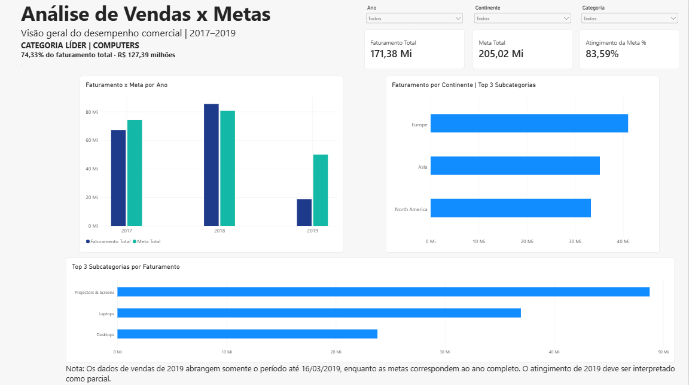
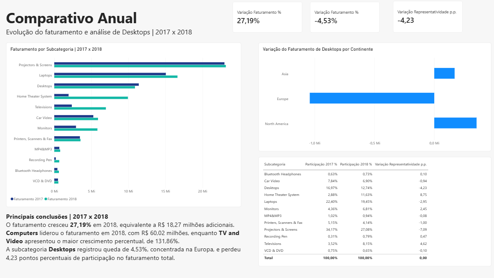
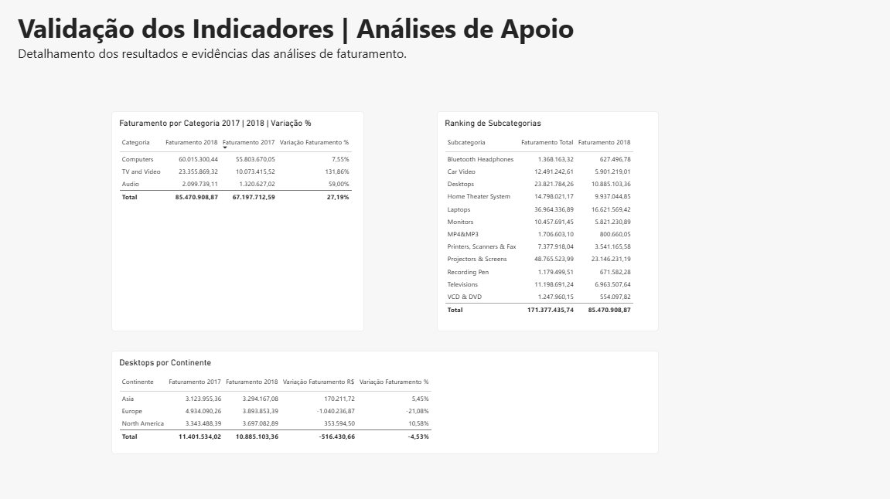

# 📊 Análise de Vendas x Metas | Power BI

### Desafio Técnico de Business Intelligence — Directy

Projeto desenvolvido em Power BI com o objetivo de analisar o desempenho comercial de uma empresa, avaliar o cumprimento das metas de faturamento e identificar oportunidades de melhoria por categoria de produto, subcategoria e continente.

O período analisado compreende **01/01/2017 a 16/03/2019**.

## 🎯 Objetivos do projeto

- Analisar o faturamento e o cumprimento das metas estabelecidas.
- Comparar o desempenho comercial entre 2017 e 2018.
- Identificar as categorias e subcategorias com maior faturamento.
- Investigar quedas de faturamento e suas concentrações regionais.
- Avaliar mudanças na representatividade das subcategorias.
- Apresentar insights para apoiar decisões gerenciais.

## 🛠️ Tecnologias utilizadas

- **Power BI Desktop:** modelagem, análises e dashboards.
- **Power Query (linguagem M):** tratamento, transformação e integração dos dados.
- **DAX:** criação de medidas e indicadores de desempenho.
- **Excel:** arquivos de origem disponibilizados no desafio.
- **GitHub:** documentação e apresentação do projeto.

## 🗂️ Preparação e tratamento dos dados

Os dados foram preparados no Power Query antes da construção do modelo analítico.

As principais etapas incluíram:

- Ajuste dos tipos de dados.
- Tratamento de valores nulos e inconsistências.
- Verificação de duplicidades e identificadores.
- Padronização das informações de clientes e localização.
- Tratamento das informações de produtos, categorias e subcategorias.
- Integração das informações de clientes e produtos com suas respectivas dimensões.
- Consolidação das metas de 2017, 2018 e 2019 em uma única tabela.
- Criação de colunas calculadas para faturamento e custo.

**Cálculo do valor de venda:**

```powerquery
[Preço Unitário] * [Quantidade] - [Valor Desconto]
```

**Cálculo do valor de custo:**

```powerquery
[Custo Unitário] * [Quantidade]
```

## 🧩 Modelagem de dados

Foi construído um modelo relacional com tabelas de vendas, clientes, produtos, calendário e metas.

As principais tabelas utilizadas foram:

| Tabela | Finalidade |
|---|---|
| Vendas | Registros de transações e valores comerciais |
| Cliente_final | Dados dos clientes e localização |
| Produto | Produtos, marcas, categorias e subcategorias |
| Metas | Metas anuais por categoria e continente |
| Calendario | Análises por data |
| DimAno | Integração dos filtros anuais |
| DimCategoria | Dimensão compartilhada de categorias |
| DimContinente | Dimensão compartilhada de continentes |

Foram configurados relacionamentos predominantemente de **um para muitos (1:*)**, com filtros direcionados das dimensões para as tabelas relacionadas.

As metas foram tratadas na granularidade anual, por categoria e continente.

## 📐 Principais medidas DAX

**Faturamento Total**

```dax
Faturamento Total =
SUM(Vendas[Valor Venda])
```

**Meta Total**

```dax
Meta Total =
SUM(Metas[Valor Meta])
```

**Atingimento da Meta**

```dax
Atingimento da Meta % =
DIVIDE(
    [Faturamento Total],
    [Meta Total]
)
```

**Variação do Faturamento**

```dax
Variação Faturamento % =
DIVIDE(
    [Faturamento 2018] - [Faturamento 2017],
    [Faturamento 2017]
)
```

Também foram desenvolvidas medidas de participação no faturamento, variação de representatividade, lucro bruto, margem e outros indicadores complementares.

## 📊 Dashboards desenvolvidos

### 01 — Visão Geral

Apresenta os indicadores gerais de faturamento, metas e atingimento, além de análises de categorias, subcategorias e continentes.

**Recursos disponíveis:** filtros interativos por ano, categoria e continente, comparação de faturamento versus meta e rankings comerciais.



### 02 — Comparativo Anual

Compara o desempenho de 2017 e 2018, destacando crescimento, quedas de faturamento e alterações na participação das subcategorias.

Inclui uma investigação específica da subcategoria Desktops e dos resultados por continente.



### 03 — Análises de Apoio

Reúne tabelas analíticas para validar e detalhar os indicadores apresentados nas páginas principais.

Inclui faturamento por categoria, ranking de subcategorias e desempenho regional de Desktops.



## 🔎 Principais resultados e insights

### 1. Desempenho geral

| Indicador | Resultado |
|---|---:|
| Faturamento total | R$ 171.377.435,74 |
| Meta total | R$ 205.023.845,01 |
| Atingimento acumulado | 83,59% |
| Crescimento de 2018 em relação a 2017 | +27,19% |

O faturamento de 2018 apresentou crescimento de aproximadamente **R$ 18,27 milhões** em relação a 2017.

Além disso, o atingimento da meta evoluiu de **90,37% em 2017 para 105,88% em 2018**.

### 2. Categoria com maior faturamento

**Computers** foi a categoria líder, representando **74,33% do faturamento do período completo**, equivalente a aproximadamente R$ 127,39 milhões.

Em 2018, Computers faturou **R$ 60,02 milhões**, mantendo a liderança em valor absoluto.

### 3. Categoria com maior crescimento percentual

**TV and Video** apresentou o maior crescimento percentual entre 2017 e 2018, com aumento de **131,86%**.

Isso demonstra que a categoria com maior faturamento não foi necessariamente a categoria com maior expansão relativa.

### 4. Subcategorias de destaque

As três subcategorias com maior faturamento foram:

1. Projectors & Screens
2. Laptops
3. Desktops

Essas mesmas subcategorias lideraram o faturamento de 2018.

Considerando o faturamento combinado das três subcategorias no período completo, o ranking regional foi:

1. Europe
2. Asia
3. North America

### 5. Investigação da queda de Desktops

A subcategoria Desktops apresentou redução de **4,53% no faturamento** entre 2017 e 2018.

| Indicador | Resultado |
|---|---:|
| Faturamento 2017 | R$ 11.401.534,02 |
| Faturamento 2018 | R$ 10.885.103,36 |
| Variação absoluta | −R$ 516.430,66 |
| Variação percentual | −4,53% |

A **Europa** foi a principal responsável pela queda, apresentando redução de aproximadamente **R$ 1,04 milhão**, parcialmente compensada pelo crescimento na Ásia e na América do Norte.

A participação de Desktops no faturamento total passou de **16,97% para 12,74%**, representando uma redução de **4,23 pontos percentuais** (aproximadamente 24,93% de redução relativa da participação).

## 💡 Recomendações de negócio

Com base nos resultados identificados, destacam-se três oportunidades para investigação gerencial:

- **Desktops na Europa:** analisar fatores comerciais e regionais associados à queda de faturamento.
- **TV and Video:** investigar os fatores que impulsionaram o crescimento e avaliar a sustentabilidade desse desempenho.
- **Metas de 2019:** acompanhar o faturamento realizado frente ao ritmo esperado e revisar projeções considerando a sazonalidade e os resultados dos anos anteriores.

Essas recomendações são hipóteses gerenciais baseadas na análise descritiva, não conclusões causais.

## ⚠️ Limitações da análise

A base de vendas de 2019 contém registros somente até **16/03/2019**, enquanto as metas correspondem ao ano completo.

Por esse motivo, a comparação de atingimento de 2019 deve ser interpretada como parcial.

A análise de crescimento anual concentra-se nos períodos completos de **2017 e 2018**.

O relatório permite explorar as informações com filtros interativos; conclusões referentes ao período completo ou a anos específicos devem considerar o contexto temporal indicado.

## 📁 Estrutura do repositório

```text
analise-vendas-metas-directy/
├── README.md
└── dashboard/
    ├── Teste directy.pbix
    └── Imagens/
        ├── Visao-Geral.png
        ├── Comparativo-anual.png
        └── analises-apoio.png
```

## ▶️ Como visualizar o projeto

1. Baixe o arquivo `dashboard/Teste directy.pbix`.
2. Abra o arquivo utilizando o Power BI Desktop.
3. Navegue pelas três páginas do relatório.
4. Utilize os filtros disponíveis na página Visão Geral para explorar os indicadores.

As capturas de tela também estão disponíveis neste repositório para visualização rápida.

---

**Projeto desenvolvido como parte de um desafio técnico de Business Intelligence, com foco em transformação de dados, modelagem analítica, visualização e interpretação de resultados.**
